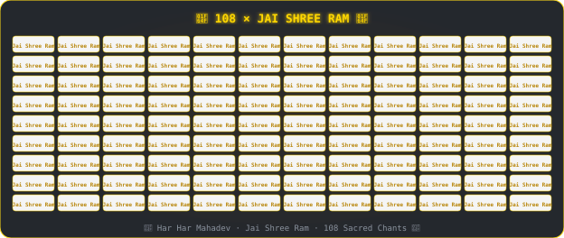

<div align="center">

<!-- Animated Hero Banner -->


<br>


<br>


&nbsp;

&nbsp;


<br><br>


</div>

---

# 💙 About Me

```yaml
Name: Ankita Salaria
Role: CS Student · Go & Python Developer · K8s Tooling Builder

Interests:
  - Kubernetes & Cloud Native
  - Runtime Security (KubeArmor)
  - Observability & Dev Tooling
  - Open Source (CNCF)

Currently Building:
  - K8s Health Monitor (Python)
  - K8s Pod Analyzer (Go)
  - K8s Pod Recommender (Go)
  - Container Lint (Python)

Open To:
  - GSoC 2027 (CNCF/KubeArmor)
  - LFX Mentorship
  - Open Source Collaborations
  - Internships
```

<div align="center">

</div>

---

## ⚡ Tech Stack

<p align="center">
  
</p>

<table align="center">
<tr>
<td valign="top" width="50%">

### Backend & Systems

<p align="center">
  
</p>

</td>

<td valign="top" width="50%">

### Frontend

<p align="center">
  
</p>

</td>
</tr>

<tr>
<td valign="top" width="50%">

### DevOps & Cloud

<p align="center">
  
</p>

</td>

<td valign="top" width="50%">

### Tools & AI

<p align="center">
  
</p>

</td>
</tr>
</table>

---

# 📈 GitHub Analytics

<div align="center">


</div>

---

# 💻 Live Terminal

<div align="center">



</div>

---

# 🎯 Currently Building

<div align="center">


<br><br>

**KubeArmor Contribution** · **K8s Pod Analyzer** · **K8s Health Monitor**

</div>

---

# 🙏 108 × Jai Shree Ram

<div align="center">



<br>

*"Har Har Mahadev · Jai Shree Ram · 108 Sacred Chants"*

</div>

---

# 🐍 Contribution Snake

<div align="center">


</div>

---

# 🌐 Connect

<div align="center">

<a href="https://github.com/Ankitavasudev">

</a>

<a href="https://linkedin.com/in/ankitasalaria21">

</a>

<a href="mailto:ankita@users.noreply.github.com">

</a>

</div>

<br>

<div align="center">


</div>